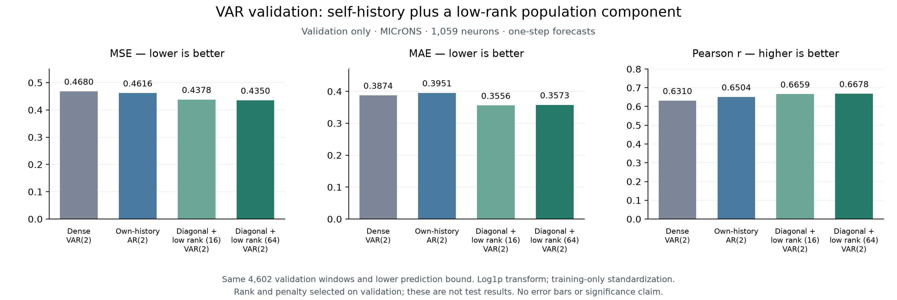

# VAR improvements: validation update, 22 October 2026

I extended the population VAR baseline without anatomical connectivity. I
tested additional lags, a rank constraint on the entire coefficient matrix,
an independent self-history control, and a model with separate self-history
terms plus a low-rank population component.

**These are one-step validation results.** I subsequently evaluated the frozen
selected configuration: see the [one-step test report](var_test_results.md).
The original VAR1 test report is [separate](var_results.md). These validation
scores should not be ranked directly against the group's GRU/GNN test scores.

## Latest matched comparison



| Model | Stored values | Validation MSE ↓ | MAE ↓ | Pearson ↑ |
|---|---:|---:|---:|---:|
| Dense VAR(2) | 2,244,021 | 0.468003 | 0.387368 | 0.630975 |
| Independent AR(2) | 3,177 | 0.461606 | 0.395071 | 0.650416 |
| Diagonal + low-rank VAR(2), r=16 | 54,009 | 0.437796 | **0.355642** | 0.665872 |
| Diagonal + low-rank VAR(2), r=64 | 206,505 | **0.435024** | 0.357310 | **0.667777** |

I selected rank 64 by bounded validation MSE: 5.76% lower than independent AR
and 7.05% lower than dense VAR, with 90.8% fewer stored values than dense VAR.
Rank 16 is a compact alternative with slightly better MAE. Counts include
factor redundancy and are not statistical effective degrees of freedom.

## Data and selection

- Session 4_7, shared timestamp-corrected `cave_proofread` processed files;
  37,840 frames, 1,059 neurons, 324/71/69 train/validation/test trials.
- Clip negative raw values to zero, apply log1p, standardize with training-only
  per-neuron mean and std + 1e-6. No graph or exogenous features are used.
- Identical 21,568 training targets and 4,602 validation windows after context
  15; P=2 uses the latest two frames. Windows stay within trials.
- Bound predictions at transformed raw zero (`-training_mu/training_sd`),
  not at zero in standardized units. Full local runs retain raw/bounded scores.
- Control lambdas: 0.0001/0.001/0.01/0.1; both families select 0.0001.
- Added-model grid: ranks 16/64 and population penalties 0.01/0.1. Self-history
  penalty stays at the independent-control value, 0.0001. The winner uses
  population penalty 0.1 and iteration 7.
- Iteration 0 reproduces independent AR. Alternating exact conditional solves
  fit the two components; validation retains the best iterate. Training-objective
  tolerance stopped the winner, rather than the iteration cap or patience.
  The four-candidate pilot took about 13 seconds on the recorded machine.

## What I learned

Using two lags gave a modest improvement: in the controlled unbounded
comparison, P=2 validation MSE was 0.492414 versus 0.509757 for P=1. P=4 had
lower training error but worse validation error (0.522633) at selected penalties.

Constraining the entire stacked matrix to ranks 16–512 did not help: the best
tested constrained MSE was 0.569161 at rank 512 versus 0.492414 unrestricted.
That constraint compresses self-history together with population effects.
I checked fitting against independent numerical solutions and verified exact
agreement with the shared loader's normalized activity and trial splits.

The latest model instead writes `B = E(d) + A @ V.T`: E stacks diagonal
self-history terms; only the added component is rank constrained. The total
model can retain full rank. I penalize self-history and the factor product
separately, retaining an unpenalized intercept. The structure is motivated by
[Wagenmaker et al., NeurIPS 2024](https://arxiv.org/abs/2412.02529); I use a
different task, a stacked rank constraint and a regularized conditional solver.

## Limits and next steps

The gain supports the combined design, rather than isolating the effect of
rank alone: structure and regularization changed together. A matched full-rank
population component with the same separate penalties is a useful next control.
The added component may include diagonal entries, and self-history is updated
jointly; its gain is not a pure measure of cross-neuron information or causality.

This is one session, with repeated validation selection and no uncertainty
intervals. The joint optimization is nonconvex and has no global-optimum
guarantee. Agree the final horizon, bounds, inputs and target windows before
test evaluation; see the [comparison protocol](comparison_protocol.md). If
five-step forecasting is primary, inspect multistep validation before freezing
the selection for that task.

## Reproduction and artifacts

The [VAR README](../models/VAR/README.md#latest-workflow-from-a-processed-session)
gives a fresh-session workflow that generates the controls and the added-model
comparison; it does not depend on a locally ignored checkpoint.

Recorded run IDs: `lag_selection_6a11191a`, `rank_selection_4999029d`,
`controls_ba3ba28d`, `diagonal_rank_4434eb4e`. Recordings, checkpoints and full
run exports stay ignored. I share only the
[aggregate result JSON](results/var_validation_2026-10-22.json),
[PNG](figures/var_validation_comparison.png) and
[PDF](figures/var_validation_comparison.pdf).

To regenerate the exports from a completed run, without refitting or scoring:

```bash
./.venv/bin/python models/VAR/plot_validation.py \
  --run-dir models/VAR/runs/diagonal_reference \
  --output-dir docs/figures \
  --summary-json docs/results/var_validation_2026-10-22.json
```

The JSON records input/source fingerprints and versions. The 56 numerical and
protocol checks cover independent least-squares/SVD references, objective
descent, trial isolation, bounds, selection without test influence, provenance
checks and checkpoint replay.
