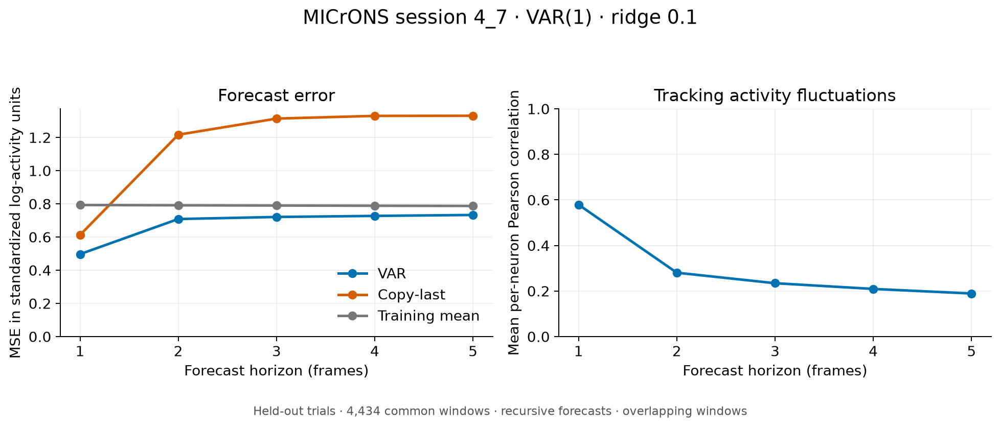

# Original MICrONS VAR baseline result

I completed this original VAR(1) experiment on 2026-10-10.
For my subsequent validation-only improvements, see [VAR improvements](var_improvements.md).
This is a real single-session forecasting experiment.
VAR uses population activity without anatomical graph constraints. These scores
do not establish whether the connectome improves forecasting.

## Data and protocol

- Session: 4_7, processed files supplied by Andrei; graph provenance is
  `cave_proofread (CAVE v1926)` with 947 directed edges. VAR does not use edges.
- Activity: 37,840 timesteps, 1,059 neurons, 464 chronological trials.
- Whole-trial split by normalized trial start time: 324 train / 71 validation /
  69 test trials; 26,428 / 5,667 / 5,745 rows respectively.
- Preprocessing: clip negative activity to zero, apply log1p, then standardize
  each neuron using training mean and training std + 1e-6 only. There are
  680,743 negative values (about 1.70% of entries) before clipping.
- Model: unrestricted population VAR(1), separate intercepts, ridge penalty;
  1,122,540 fitted parameters and 26,104 within-trial training pairs.
- Select lambda by one-step validation MSE on 4,602 validation origins, with
  a 15-frame context. VAR(1) uses the last frame of that context.
- Evaluate the selected model on 4,434 test origins with a common 15-frame
  context and five future targets. Forecasts are recursive within each window;
  they use no future observed activity. Windows never cross trial boundaries.
- Copy-last and training-mean baselines use exactly the same test targets.
  Metrics are in standardized log-transformed units. Pearson is computed per
  neuron across origins, then averaged across neurons.

## Validation selection

| Ridge penalty | One-step validation MSE |
|---:|---:|
| 0.01 | 0.505693429 |
| 0.1 | 0.504856851 |
| 1 | 0.549148497 |

Selected lambda: **0.1**. Only training trials are used for fitting.
Validation/test targets are not added for refitting.

## Held-out test results




| Horizon (frames) | VAR MSE | Copy-last MSE | Training-mean MSE | VAR Pearson |
|---:|---:|---:|---:|---:|
| 1 | 0.496943 | 0.612430 | 0.793000 | 0.5792 |
| 2 | 0.708653 | 1.216949 | 0.791393 | 0.2805 |
| 3 | 0.721079 | 1.314014 | 0.790024 | 0.2343 |
| 4 | 0.727485 | 1.330349 | 0.788751 | 0.2093 |
| 5 | 0.733091 | 1.331120 | 0.787453 | 0.1892 |

VAR has lower MSE than both simple baselines at all five horizons. One-step MSE is 18.9%
lower than copy-last and 37.3% lower than the mean. At five steps, the respective
reductions are 44.9% and 6.9%; correlation falls to 0.1892, indicating limited
longer-horizon tracking. These are MSE reductions, not accuracy percentages.
At h=1, copy-last has slightly higher Pearson correlation (0.5984) than VAR
(0.5792), despite worse MSE. Lower squared error does not guarantee higher
correlation.

## Interpretation and comparison limits

- This is a point estimate from one session, without uncertainty intervals.
  The 4,434 forecast windows overlap and are not independent samples.
- Trials are temporally separated, but movie identities are not disjoint:
  51 of the 69 unique test stimulus hashes also occur in training. The result
  describes forecasting later trials; it does not test generalization to
  unseen movies or to another session/animal.
- A controlled comparison with GVAR/GRU requires the same activity files,
  preprocessing, splits, available inputs, origins, horizons and metric definitions.
  See [comparison protocol](comparison_protocol.md) for the reviewed settings
  and choices requiring group agreement.
- Do not choose subsequent model settings based on these test scores.

## Reproduction and artifacts

From the repository root, with the group session in
`processed/session_4_7_cave_proofread/`:

```bash
./.venv/bin/python models/VAR/train.py \
  --dataset cave_proofread \
  --data-kind microns \
  --lambdas 0.01 0.1 1
```

Each run creates a new `models/VAR/runs/run_<id>/` directory containing
`model.npz`, `results.json` and `metrics_summary.txt`. `results.json` records
input/source SHA-256 hashes, split trial IDs, versions and configuration.
The recorded checkpoint, input/source hashes and loading were verified.
Generate the figures with:

```bash
./.venv/bin/python models/VAR/plot_results.py --run-dir models/VAR/runs/run_<id>
```

The aggregate PNG above is included with this report. Processed data,
checkpoints and full run exports remain ignored by Git.


Recorded runtime: Python 3.11.5, NumPy 2.4.6, SciPy 1.17.1.

Input SHA-256 fingerprints:

```text
X_features.npy: bec7a23dcd3f7f8ed0429a6b2810d160a0c398f64c8bbd1e81efefb61562fcf4
conditions.csv: 86978eb059cd5043ac0c2e9a1d201727f64ebff2a4c9fa655bdd2614d22ffc67
```
