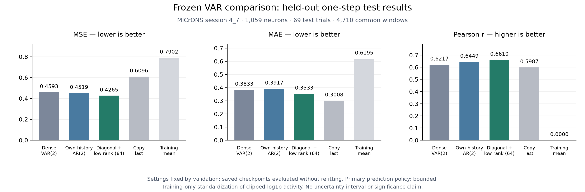

# Frozen VAR comparison: one-step test results, 22 October 2026

I froze the configuration selected on validation and evaluated its saved
checkpoint without refitting. I evaluated the saved dense VAR and independent
AR controls on the same test targets. The earlier validation results were
actual MICrONS experiments used for model development; this report measures
the frozen comparison on later trials excluded from that selection process.

## Test results



| Model | Stored values | Test MSE ↓ | RMSE ↓ | MAE ↓ | Pearson ↑ | Macro R2 ↑ |
|---|---:|---:|---:|---:|---:|---:|
| Dense VAR(2) | 2,244,021 | 0.459275 | 0.677698 | 0.383263 | 0.621666 | 0.364598 |
| Independent AR(2) | 3,177 | 0.451902 | 0.672237 | 0.391735 | 0.644888 | 0.385395 |
| Diagonal + low-rank VAR(2), r=64 | 206,505 | **0.426460** | **0.653039** | 0.353326 | **0.660980** | **0.426612** |
| Copy-last | — | 0.609554 | 0.780739 | **0.300847** | 0.598686 | 0.196330 |
| Training mean | — | 0.790222 | 0.888944 | 0.619534 | 0.000000 | -0.120118 |

The selected model reduces test MSE by 5.63% relative to independent AR and
7.14% relative to dense VAR. It also improves MAE and Pearson relative to both
fitted controls. Copy-last retains lower MAE: the selected model does not dominate
every baseline on every metric. Stored factor counts include redundancy.

## Frozen protocol

- Session 4_7, 1,059 neurons; 69 test trials and 4,710 one-step windows with a
  15-frame context. All models use identical targets within trial boundaries.
- Training-only normalization of clipped-log1p activity; no anatomical graph
  or exogenous inputs. Primary predictions use the per-neuron lower bound
  `-training_mu/training_sd`, fixed during validation development.
- Selected model: P=2, rank=64, self-history penalty 0.0001, population penalty
  0.1, saved iteration 7. Dense and independent controls each use lambda 0.0001.
- No validation/test targets were added for refitting. I did not evaluate
  other ranks or choose a different configuration from these test scores.
- Source/input fingerprints, checkpoint parameters and validation replay
  are verified first. `frozen_protocol.json` is written before test forecasts.
  It records fixed settings, trial IDs and checkpoint/evaluator fingerprints.
- The original VAR1 test scores were reported earlier. The new candidate
  search used validation; the test split was not globally unseen throughout
  the entire project's history.

## Validation versus test

| Model | Bounded validation MSE | Bounded test MSE |
|---|---:|---:|
| Dense VAR(2) | 0.468003 | 0.459275 |
| Independent AR(2) | 0.461606 | 0.451902 |
| Diagonal + low-rank VAR(2), r=64 | 0.435024 | 0.426460 |

The validation improvement carries over to these test trials. The two splits
have different activity distributions; a lower test score than validation is
not evidence of a problem. These remain one-session point estimates with
overlapping windows and no uncertainty interval. They describe later trials,
not unseen movies, sessions or animals. The combined change in structure and
regularization does not isolate the rank restriction's contribution.

This is the best configuration among the candidates I tested on validation,
not a claim of a globally optimal VAR model. It is a final one-step comparison
for this frozen configuration, not a five-step forecasting result. Group
rankings still require matched inputs, origins, prediction policies and metrics.

## Reproduction and artifacts

After generating the validation-selected checkpoints with the
[VAR workflow](../models/VAR/README.md#latest-workflow-from-a-processed-session):

```bash
./.venv/bin/python models/VAR/evaluate_test.py \
  --dataset cave_proofread \
  --run-dir models/VAR/runs/diagonal_reference \
  --controls-run models/VAR/runs/controls_reference
```

The evaluator has no rank, penalty, horizon or model-selection options. It
only loads and scores the supplied frozen one-step checkpoints. Its ignored
output contains `frozen_protocol.json`, `results.json` and `metrics_summary.txt`;
unbounded scores are retained only as a predeclared diagnostic policy.

Recorded run: `test_one_step_57614e4a`; selected checkpoint run:
`diagonal_rank_4434eb4e`; controls: `controls_ba3ba28d`.
The [aggregate JSON](results/var_test_2026-10-22.json),
[PNG](figures/var_test_comparison.png) and [PDF](figures/var_test_comparison.pdf)
contain no recordings, prediction arrays or checkpoint weights.

Six new checks verify no fitting calls, a protocol ledger before test scoring,
agreement with independently calculated metrics, immutable checkpoint weights,
provenance rejection and identical results across scoring batch sizes. All 62
VAR checks passed before this evaluation.
